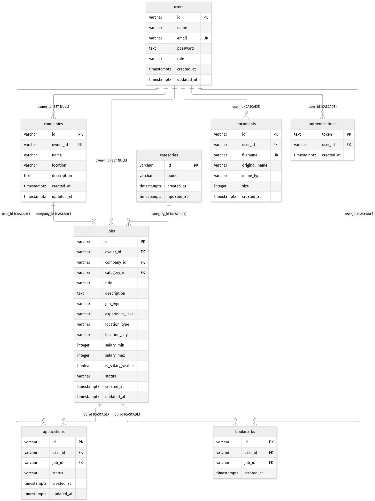

# 💼 OpenJob RESTful API (Versi 2)

[](https://nodejs.org/)
[](https://expressjs.com/)
[](https://www.postgresql.org/)
[](https://redis.io/)
[](https://www.rabbitmq.com/)
[](https://jwt.io/)

> **Proyek Akhir:** _OpenJob RESTful API Versi 2_  
> Program **Belajar Fundamental Back-End dengan JavaScript** — **Dicoding Indonesia**  
> Kolaborasi Program **Asah led by Dicoding Supported by GoTo** & **PLK Akomodasi Klaim Universitas Negeri Yogyakarta (UNY) Studi Mandiri**.

---

## 📑 Daftar Isi

- [Tentang Proyek](#-tentang-proyek)
- [Kriteria Proyek Akhir & Fitur Lengkap](#-kriteria-proyek-akhir--fitur-lengkap)
  - [Kriteria 1: Unggah & Tampilkan Berkas Dokumen PDF](#kriteria-1-restful-api-dapat-mengunggah-berkas-dokumen-pdf)
  - [Kriteria 2: Caching pada RESTful API (Redis)](#kriteria-2-menerapkan-caching-pada-restful-api-redis)
  - [Kriteria 3: Message Queue (RabbitMQ) & Email Consumer](#kriteria-3-menerapkan-message-queue-rabbitmq)
  - [Fondasi V1 yang Dipertahankan](#fondasi-v1-yang-dipertahankan)
- [Daftar Endpoint REST API](#-daftar-endpoint-rest-api)
- [Format Response](#-format-response)
- [Struktur Direktori](#-struktur-direktori)
- [Skema Database & ERD](#-skema-database--erd)
- [Teknologi yang Digunakan](#-teknologi-yang-digunakan)
- [Panduan Instalasi & Menjalankan Proyek](#-panduan-instalasi--menjalankan-proyek)
  - [Prasyarat](#prasyarat)
  - [Langkah Instalasi](#langkah-instalasi)
  - [Konfigurasi Environment](#konfigurasi-environment)
  - [Menjalankan Infrastruktur Lokal (Docker Compose)](#menjalankan-infrastruktur-lokal-docker-compose)
  - [Menyiapkan Database & Menjalankan Migration](#menyiapkan-database--menjalankan-migration)
  - [Menjalankan HTTP Server & Consumer](#menjalankan-http-server--consumer)
  - [Skrip NPM](#skrip-npm)
- [Pengujian dengan Postman & cURL](#-pengujian-dengan-postman--curl)
  - [Menjalankan Collection Runner](#1-menjalankan-collection-runner)
  - [Pengujian Manual Folder Documents](#2-pengujian-manual-folder-mandatory-documents)
  - [Mereset Database & Cache untuk Uji Ulang](#3-mereset-database--cache-untuk-uji-ulang)
- [Dokumentasi Arsitektur & Keputusan Teknis](#-dokumentasi-arsitektur--keputusan-teknis)
- [Penulis](#-penulis)

---

## 📖 Tentang Proyek

**OpenJob RESTful API (Versi 2)** adalah pengembangan lanjutan dari platform perekrutan karyawan OpenJob. Selain mempertahankan pengelolaan pengguna, perusahaan, kategori pekerjaan, lowongan, lamaran, bookmark, dan autentikasi JWT dari Versi 1, Versi 2 menghadirkan tiga kapabilitas utama skala produksi:

1. **Penyimpanan & penayangan berkas CV/Resume PDF** menggunakan `multer` dengan validasi berlapis (ukuran, MIME type, ekstensi, dan _magic bytes_ `%PDF-`).
2. **Server-side caching menggunakan Redis** berpola _cache-aside_ dengan TTL 1 jam, header sumber data (`X-Data-Source`), proteksi kepemilikan data pada cache, dan invalidasi otomatis setiap terjadi mutasi data.
3. **Pemrosesan asinkron menggunakan RabbitMQ & Nodemailer** melalui proses _consumer_ terpisah yang mengirimkan email notifikasi lamaran baru secara eksklusif kepada pemilik lowongan (_job owner_).

---

## 🏆 Kriteria Proyek Akhir & Fitur Lengkap

### Kriteria 1: RESTful API dapat Mengunggah Berkas Dokumen PDF

- **Basic & Skilled**
  - Menerima unggahan berkas melalui `multipart/form-data` (field `document`) menggunakan library **`multer`**.
  - Validasi ukuran berkas maksimal **5 MB** (`MAX_UPLOAD_SIZE_BYTES = 5 * 1024 * 1024`).
  - Validasi MIME type **`application/pdf`**, ekstensi `.pdf`, serta pemeriksaan _magic bytes_ **`%PDF-`** pada isi berkas untuk mencegah pemalsuan ekstensi/MIME.
  - Metadata berkas yang berhasil diunggah disimpan di tabel **`documents`** (dikelola melalui migration baru berawalan timestamp otomatis `node-pg-migrate`).
  - Nama berkas di disk dan ID dokumen dibangkitkan dengan **`nanoid`** sehingga bebas benturan nama maupun serangan _path traversal_.
  - Apabila penyimpanan metadata ke PostgreSQL gagal setelah berkas ditulis ke disk, berkas otomatis dihapus agar tidak meninggalkan _orphan file_.
- **Advanced**
  - Menampilkan/mengunduh berkas PDF melalui `GET /documents/:id` dengan header `Content-Type: application/pdf` dan `Content-Disposition: inline; filename="<sanitized>"`.

### Kriteria 2: Menerapkan Caching pada RESTful API (Redis)

- **Basic & Skilled**
  - Menggunakan **Redis** (`redis` client resmi) dengan masa simpan (**TTL**) **1 jam (`3600` detik)**.
  - Konfigurasi Redis dibaca dari environment variable **`REDIS_HOST`** (serta `REDIS_PORT` dan `REDIS_PASSWORD` opsional).
- **Advanced**
  - Caching diterapkan pada endpoint detail maupun list:
    - `GET /companies/:id` (`company:{id}`)
    - `GET /users/:id` (`user:{id}`) dan `GET /profile`
    - `GET /applications/:id` (`application:{id}`)
    - `GET /applications/user/:userId` (`applications:user:{userId}`)
    - `GET /applications/job/:jobId` (`applications:job:{jobId}`)
    - `GET /bookmarks` dan `GET /profile/bookmarks` (`bookmarks:user:{userId}`)
  - Mengembalikan header custom **`X-Data-Source: cache`** saat _cache hit_ dan **`X-Data-Source: database`** saat _cache miss_ (mengikuti assertion Postman Collection V2).
  - **Invalidasi cache menyeluruh:**
    - `POST / PUT / DELETE /companies` menghapus cache `company:{id}` (serta cache turunan saat penghapusan perusahaan).
    - `PUT /users/:id` menghapus cache `user:{id}`.
    - `POST /applications` menghapus cache `applications:user:{userId}` dan `applications:job:{jobId}`.
    - `PUT /applications/:id` menghapus cache `application:{id}`, `applications:user:{userId}`, dan `applications:job:{jobId}`.
    - `POST / DELETE /jobs/:jobId/bookmark` menghapus cache `bookmarks:user:{userId}`.
    - **Tambahan anti-data-basi:** `DELETE /applications/:id` turut menghapus cache detail serta list lamaran (`application:{id}`, `applications:user:{userId}`, `applications:job:{jobId}`), dan `DELETE /jobs/:id` menghapus cache `applications:job:{jobId}` beserta cache lamaran/bookmark terkait.

### Kriteria 3: Menerapkan Message Queue (RabbitMQ)

- **Basic & Skilled**
  - Saat kandidat melamar pekerjaan (`POST /applications`), `ProducerService` mengirim pesan ke queue _durable_ `job_applications` di **RabbitMQ** setelah transaksi database _commit_.
  - Payload pesan hanya berisi **`{ "application_id": "<id>" }`** dengan sifat _persistent_.
  - Kredensial RabbitMQ dibaca dari environment variables: **`RABBITMQ_HOST`**, **`RABBITMQ_PORT`**, **`RABBITMQ_USER`**, dan **`RABBITMQ_PASSWORD`** (serta dukungan opsional `AMQP_URL`).
  - Tersedia program **consumer terpisah** (`src/consumer/index.js`) yang memproses antrean secara _asynchronous_ dengan _manual acknowledgement_ (`ack`) dan _bounded retry_.
- **Advanced**
  - Consumer melakukan query ke PostgreSQL berdasarkan `application_id` untuk mencari **pemilik lowongan (`job owner`)** serta rincian pelamar (tidak ada alamat email yang di-_hardcode_).
  - Mengirimkan email notifikasi menggunakan **Nodemailer** (`MAIL_HOST`, `MAIL_PORT`, `MAIL_USER`, `MAIL_PASSWORD`) **hanya kepada pemilik lowongan** (bukan kepada pelamar).
  - Isi email memuat tiga informasi wajib dari database: **Nama Pelamar**, **Email Pelamar**, dan **Tanggal Lamaran** (beserta judul lowongan dan nama perusahaan).

### Fondasi V1 yang Dipertahankan

- Database PostgreSQL ternormalisasi (3NF), _parameterized SQL queries_ (`$1, $2`), transaksi `BEGIN/COMMIT/ROLLBACK` dengan `FOR SHARE`, serta autentikasi/otorisasi berbasis **JWT Bearer Token** (`ACCESS_TOKEN_KEY` & `REFRESH_TOKEN_KEY`) dan **bcrypt**.
- Validasi terpusat menggunakan **Joi** (termasuk validasi seluruh environment variable saat _startup_), _structured logging_ dengan **Pino** tanpa `console.log`, keamanan HTTP dasar dengan **Helmet** & **CORS**, serta **graceful shutdown** (`SIGINT`/`SIGTERM`) pada HTTP server maupun consumer.

---

## 🌐 Daftar Endpoint REST API

Base URL lokal: `http://localhost:3000`

### Endpoint Publik

| Method | Endpoint                     | Cache Redis    | Deskripsi                                                          |
| :----- | :--------------------------- | :------------- | :----------------------------------------------------------------- |
| `POST` | `/users`                     | —              | Registrasi pengguna baru                                           |
| `GET`  | `/users/:id`                 | `user:{id}`    | Detail pengguna (`X-Data-Source`)                                  |
| `POST` | `/authentications`           | —              | Login, memperoleh `accessToken` dan `refreshToken`                 |
| `PUT`  | `/authentications`           | —              | Memperbarui `accessToken` menggunakan `refreshToken`               |
| `GET`  | `/documents`                 | —              | Daftar metadata dokumen PDF yang telah diunggah                    |
| `GET`  | `/documents/:id`             | —              | Menampilkan/mengunduh berkas PDF (`Content-Type: application/pdf`) |
| `GET`  | `/companies`                 | —              | Daftar seluruh perusahaan                                          |
| `GET`  | `/companies/:id`             | `company:{id}` | Detail perusahaan (`X-Data-Source`)                                |
| `GET`  | `/categories`                | —              | Daftar seluruh kategori pekerjaan                                  |
| `GET`  | `/categories/:id`            | —              | Detail kategori pekerjaan                                          |
| `GET`  | `/jobs`                      | —              | Daftar lowongan, mendukung `?title=` dan `?company-name=`          |
| `GET`  | `/jobs/:id`                  | —              | Detail lengkap lowongan pekerjaan                                  |
| `GET`  | `/jobs/company/:companyId`   | —              | Daftar lowongan berdasarkan perusahaan                             |
| `GET`  | `/jobs/category/:categoryId` | —              | Daftar lowongan berdasarkan kategori                               |

### Endpoint Terproteksi (`Authorization: Bearer <access_token>`)

| Method   | Endpoint                     | Cache / Efek Cache & MQ                                     | Deskripsi                                                |
| :------- | :--------------------------- | :---------------------------------------------------------- | :------------------------------------------------------- |
| `DELETE` | `/authentications`           | —                                                           | Logout (menghapus refresh token aktif)                   |
| `PUT`    | `/users/:id`                 | Invalidasi `user:{id}`                                      | Memperbarui `name` & `email` akun sendiri                |
| `POST`   | `/documents`                 | —                                                           | Mengunggah berkas PDF (`multipart/form-data`, maks 5 MB) |
| `DELETE` | `/documents/:id`             | —                                                           | Menghapus dokumen PDF milik sendiri                      |
| `GET`    | `/profile`                   | Baca `user:{id}`                                            | Profil pengguna yang sedang login                        |
| `GET`    | `/profile/applications`      | —                                                           | Daftar lamaran milik pengguna yang sedang login          |
| `GET`    | `/profile/bookmarks`         | Baca `bookmarks:user:{userId}`                              | Daftar bookmark milik pengguna yang sedang login         |
| `POST`   | `/companies`                 | Invalidasi `company:{id}`                                   | Membuat perusahaan baru                                  |
| `PUT`    | `/companies/:id`             | Invalidasi `company:{id}`                                   | Mengubah perusahaan (hanya pemilik)                      |
| `DELETE` | `/companies/:id`             | Invalidasi `company:{id}` & cache turunan                   | Menghapus perusahaan (hanya pemilik)                     |
| `POST`   | `/categories`                | —                                                           | Membuat kategori pekerjaan                               |
| `PUT`    | `/categories/:id`            | —                                                           | Mengubah kategori pekerjaan                              |
| `DELETE` | `/categories/:id`            | —                                                           | Menghapus kategori pekerjaan                             |
| `POST`   | `/jobs`                      | —                                                           | Membuat lowongan pada perusahaan milik sendiri           |
| `PUT`    | `/jobs/:id`                  | —                                                           | Mengubah lowongan (hanya pemilik)                        |
| `DELETE` | `/jobs/:id`                  | Invalidasi `applications:job:{id}` & cache turunan          | Menghapus lowongan (hanya pemilik)                       |
| `POST`   | `/applications`              | Invalidasi list lamaran + Publish RabbitMQ `application_id` | Melamar pekerjaan                                        |
| `GET`    | `/applications`              | —                                                           | Daftar seluruh lamaran yang dapat diakses pengguna       |
| `GET`    | `/applications/:id`          | `application:{id}` (`X-Data-Source`)                        | Detail lamaran (pelamar atau pemilik lowongan)           |
| `GET`    | `/applications/user/:userId` | `applications:user:{userId}` (`X-Data-Source`)              | Daftar lamaran berdasarkan user                          |
| `GET`    | `/applications/job/:jobId`   | `applications:job:{jobId}` (`X-Data-Source`)                | Daftar lamaran berdasarkan lowongan                      |
| `PUT`    | `/applications/:id`          | Invalidasi detail & kedua list lamaran                      | Mengubah status lamaran (hanya pemilik lowongan)         |
| `DELETE` | `/applications/:id`          | Invalidasi detail & kedua list lamaran                      | Menghapus lamaran (pelamar atau pemilik lowongan)        |
| `POST`   | `/jobs/:jobId/bookmark`      | Invalidasi `bookmarks:user:{userId}`                        | Menyimpan lowongan ke bookmark                           |
| `GET`    | `/jobs/:jobId/bookmark/:id`  | —                                                           | Detail satu bookmark                                     |
| `DELETE` | `/jobs/:jobId/bookmark`      | Invalidasi `bookmarks:user:{userId}`                        | Menghapus bookmark berdasarkan lowongan                  |
| `GET`    | `/bookmarks`                 | `bookmarks:user:{userId}` (`X-Data-Source`)                 | Daftar seluruh bookmark milik pengguna                   |

---

## 📦 Format Response

```json
{ "status": "success", "message": "opsional", "data": {} }
{ "status": "failed", "message": "alasan kegagalan" }
```

| Status Code | Arti                                                                        |
| :---------- | :-------------------------------------------------------------------------- |
| `200`       | Permintaan berhasil (JSON atau stream berkas `application/pdf`)             |
| `201`       | Data atau dokumen berhasil dibuat                                           |
| `400`       | Payload tidak valid, berkas bukan PDF / > 5 MB / kosong, atau data duplikat |
| `401`       | Token tidak ada, tidak valid, kedaluwarsa, atau kredensial login salah      |
| `403`       | Terautentikasi tetapi bukan pemilik data yang sah                           |
| `404`       | Data, berkas dokumen, atau route tidak ditemukan                            |
| `500`       | Kesalahan internal server (detail hanya dicatat pada log server)            |

---

## 📂 Struktur Direktori

```text
Proyek Akhir-OpenJob RESTful API Versi 2/
├── docs/
│   ├── ERD-OpenJob-versi-2.png           # Diagram ERD Versi 2 (8 tabel)
│   └── ERD-OpenJob-versi-2.mmd           # Sumber diagram ERD (Mermaid)
├── migrations/                           # Migration node-pg-migrate (timestamp otomatis)
│   ├── 1793471444624_create-table-users.js
│   ├── 1793471445126_create-table-companies.js
│   ├── 1793471445613_create-table-categories.js
│   ├── 1793471446129_create-table-jobs.js
│   ├── 1793471446644_create-table-applications.js
│   ├── 1793471447144_create-table-bookmarks.js
│   ├── 1793471447644_create-table-authentications.js
│   └── 1793546483523_create-table-documents.js
├── uploads/                              # Penyimpanan berkas PDF (diabaikan git kecuali .gitkeep)
│   └── .gitkeep
├── src/
│   ├── config/
│   │   ├── database.js                   # Pool PostgreSQL bersama, transaksi & penutupan pool
│   │   ├── env.js                        # Validasi env dengan Joi & konstanta terpusat
│   │   ├── mail.js                       # Konfigurasi transporter SMTP Nodemailer
│   │   ├── rabbitmq.js                   # Koneksi & channel RabbitMQ bersama
│   │   └── redis.js                      # Koneksi client Redis bersama & reconnect strategy
│   ├── consumer/
│   │   ├── index.js                      # Entry point mandiri consumer RabbitMQ + graceful shutdown
│   │   └── listener.js                   # Pemrosesan pesan, bounded retry & pengiriman email
│   ├── controllers/                      # Handler HTTP tipis (tanpa query SQL)
│   │   ├── applicationsController.js
│   │   ├── authenticationsController.js
│   │   ├── bookmarksController.js
│   │   ├── categoriesController.js
│   │   ├── companiesController.js
│   │   ├── documentsController.js
│   │   ├── jobsController.js
│   │   ├── profileController.js
│   │   └── usersController.js
│   ├── exceptions/                       # Custom error classes (400, 401, 403, 404)
│   ├── middlewares/
│   │   ├── auth.js                       # Verifikasi JWT Bearer token
│   │   ├── errorHandler.js               # Error handler terpusat (ClientError, Multer, PG)
│   │   ├── notFound.js                   # Handler 404 route tidak ditemukan
│   │   ├── upload.js                     # Konfigurasi Multer (maks 5 MB, filter PDF)
│   │   └── validate.js                   # Middleware validasi skema Joi reusable
│   ├── routes/                           # Definisi route per resource + index.js
│   ├── services/                         # Logika bisnis, SQL berparameter & layanan infrastruktur
│   │   ├── CacheService.js               # Layanan cache-aside Redis (TTL 3600 detik)
│   │   ├── MailSender.js                 # Pengiriman email notifikasi lamaran via Nodemailer
│   │   ├── ProducerService.js            # Pengiriman pesan durable ke RabbitMQ
│   │   ├── StorageService.js             # Validasi magic bytes PDF, path aman & manajemen file
│   │   ├── applicationsService.js
│   │   ├── authenticationsService.js
│   │   ├── bookmarksService.js
│   │   ├── categoriesService.js
│   │   ├── companiesService.js
│   │   ├── documentsService.js
│   │   ├── jobsService.js
│   │   └── usersService.js
│   ├── utils/
│   │   ├── asyncHandler.js
│   │   ├── id.js
│   │   ├── logger.js                     # Structured logger berbasis Pino
│   │   ├── response.js
│   │   └── tokenManager.js
│   ├── validators/                       # Skema validasi Joi per resource
│   ├── app.js                            # Inisialisasi aplikasi Express
│   └── server.js                         # Entry point HTTP server + graceful shutdown
├── .editorconfig
├── .env.example                          # Template lengkap seluruh environment variable
├── .gitignore
├── .nvmrc                                # Menentukan Node.js v22
├── .prettierignore
├── .prettierrc
├── docker-compose.yml                    # Layanan Redis 7 & RabbitMQ 3 Management lokal
├── eslint.config.js
├── package.json
└── README.md
```

---

## 🗄️ Skema Database & ERD



| Tabel             | Keterangan                                                  | Relasi & aturan `ON DELETE`                                                                                          |
| :---------------- | :---------------------------------------------------------- | :------------------------------------------------------------------------------------------------------------------- |
| `users`           | Data pengguna. Kolom `email` bersifat **unik**.             | —                                                                                                                    |
| `documents`       | Metadata berkas PDF yang diunggah (`filename` **unik**).    | `user_id` → `users` (`CASCADE`)                                                                                      |
| `companies`       | Profil perusahaan yang dibuat pengguna.                     | `owner_id` → `users` (`SET NULL`)                                                                                    |
| `categories`      | Kategori pekerjaan.                                         | —                                                                                                                    |
| `jobs`            | Lowongan pekerjaan beserta pemilik lowongan (`owner_id`).   | `company_id` → `companies` (`CASCADE`), `category_id` → `categories` (`RESTRICT`), `owner_id` → `users` (`SET NULL`) |
| `applications`    | Lamaran kandidat. Pasangan `user_id` + `job_id` **unik**.   | `user_id` → `users` (`CASCADE`), `job_id` → `jobs` (`CASCADE`)                                                       |
| `bookmarks`       | Lowongan tersimpan. Pasangan `user_id` + `job_id` **unik**. | `user_id` → `users` (`CASCADE`), `job_id` → `jobs` (`CASCADE`)                                                       |
| `authentications` | Daftar refresh token aktif.                                 | `user_id` → `users` (`CASCADE`)                                                                                      |

---

## 💻 Teknologi yang Digunakan

- **Runtime:** [Node.js](https://nodejs.org/) LTS v22 (`>=22`, ES Modules)
- **Framework HTTP:** [Express](https://expressjs.com/) v5
- **Database & Migration:** [PostgreSQL](https://www.postgresql.org/) (`pg`) & [`node-pg-migrate`](https://salsita.github.io/node-pg-migrate/)
- **File Upload:** [`multer`](https://github.com/expressjs/multer)
- **Caching:** [Redis](https://redis.io/) (`redis`)
- **Message Broker:** [RabbitMQ](https://www.rabbitmq.com/) (`amqplib`)
- **SMTP Mailer:** [Nodemailer](https://nodemailer.com/)
- **Validasi & Keamanan:** [Joi](https://joi.dev/), [`jsonwebtoken`](https://github.com/auth0/node-jsonwebtoken), [`bcrypt`](https://github.com/kelektiv/node.bcrypt.js), [`helmet`](https://helmetjs.github.io/), [`cors`](https://github.com/expressjs/cors)
- **Logging & Kualitas Kode:** [`pino`](https://getpino.io/), [`nodemon`](https://nodemon.io/), [ESLint](https://eslint.org/), [Prettier](https://prettier.io/)

---

## 🛠️ Panduan Instalasi & Menjalankan Proyek

### Prasyarat

- **Node.js v22 LTS** dan `npm` (disarankan melalui `nvm`: `nvm use`)
- **PostgreSQL** yang aktif (menggunakan database terpisah untuk V2, contoh `openjob_v2_db`)
- **Docker & Docker Compose** (atau instalasi lokal Redis dan RabbitMQ)
- Akun SMTP pengujian (seperti [Ethereal Email](https://ethereal.email/) atau [Mailtrap](https://mailtrap.io/))

### Langkah Instalasi

1. **Aktifkan Node.js v22 dan pasang dependensi:**

   ```bash
   nvm use
   npm install
   ```

### Konfigurasi Environment

Salin berkas `.env.example` menjadi `.env` lalu lengkapi nilainya:

```bash
cp .env.example .env
```

| Variabel                                     | Keterangan                                                                 |
| :------------------------------------------- | :------------------------------------------------------------------------- |
| `HOST`, `PORT`                               | Host dan port HTTP server (default `localhost`, `3000`)                    |
| `PGUSER`, `PGPASSWORD`                       | Username dan password PostgreSQL                                           |
| `PGDATABASE`, `PGHOST`, `PGPORT`             | Nama database V2 (`openjob_v2_db`), host, dan port PostgreSQL              |
| `ACCESS_TOKEN_KEY`, `REFRESH_TOKEN_KEY`      | Secret penandatanganan JWT (minimal 16 karakter, gunakan string acak kuat) |
| `ACCESS_TOKEN_AGE`, `REFRESH_TOKEN_AGE`      | Masa berlaku token (default `3h` dan `7d`)                                 |
| `REDIS_HOST`, `REDIS_PORT`, `REDIS_PASSWORD` | Konfigurasi server Redis (`REDIS_HOST` wajib, password opsional)           |
| `RABBITMQ_HOST`, `RABBITMQ_PORT`             | Host dan port AMQP RabbitMQ (`localhost`, `5672`)                          |
| `RABBITMQ_USER`, `RABBITMQ_PASSWORD`         | Kredensial autentikasi RabbitMQ (dipakai pula oleh `docker-compose.yml`)   |
| `MAIL_HOST`, `MAIL_PORT`                     | Host dan port SMTP server (contoh `smtp.ethereal.email`, `587`)            |
| `MAIL_USER`, `MAIL_PASSWORD`                 | Kredensial akun SMTP pengirim email                                        |
| `MAIL_SENDER` _(opsional)_                   | Identitas pengirim pada header `From` email                                |

> [!WARNING]
> Jangan pernah membagikan atau meng-commit berkas `.env`. Berkas `.env` dan isi `uploads/` sudah diabaikan di `.gitignore`.

### Menjalankan Infrastruktur Lokal (Docker Compose)

Jalankan Redis dan RabbitMQ secara lokal menggunakan Docker Compose:

```bash
docker compose up -d
docker compose ps
```

Verifikasi layanan:

```bash
docker exec openjob-v2-redis redis-cli ping
docker exec openjob-v2-rabbitmq rabbitmq-diagnostics -q ping
```

- **RabbitMQ Management UI** dapat diakses pada `http://localhost:15672` menggunakan `RABBITMQ_USER` dan `RABBITMQ_PASSWORD` dari `.env`.

### Menyiapkan Database & Menjalankan Migration

Buat database baru khusus V2 (contoh `openjob_v2_db`), kemudian jalankan seluruh migration dari awal:

```bash
psql -h localhost -U postgres -c "CREATE DATABASE openjob_v2_db OWNER openjob_user;"
npm run migrate:up
```

### Menjalankan HTTP Server & Consumer

Jalankan **dua terminal terpisah** di root proyek:

1. **Terminal 1 — HTTP RESTful API Server:**

   ```bash
   npm run start:dev
   # atau mode produksi:
   npm start
   ```

2. **Terminal 2 — RabbitMQ Notification Consumer:**

   ```bash
   npm run start:consumer:dev
   # atau mode produksi:
   npm run start:consumer
   ```

### Skrip NPM

| Skrip                        | Fungsi                                                      |
| :--------------------------- | :---------------------------------------------------------- |
| `npm start`                  | Menjalankan HTTP server (produksi)                          |
| `npm run start:dev`          | Menjalankan HTTP server dengan `nodemon`                    |
| `npm run start:consumer`     | Menjalankan consumer RabbitMQ (produksi)                    |
| `npm run start:consumer:dev` | Menjalankan consumer RabbitMQ dengan `nodemon`              |
| `npm run migrate`            | Wrapper CLI `node-pg-migrate`                               |
| `npm run migrate:up`         | Menjalankan seluruh migration yang belum diterapkan         |
| `npm run migrate:down`       | Membatalkan migration terakhir (`-- 8` untuk semua 8 tabel) |
| `npm run lint`               | Memeriksa kualitas & aturan sintaks kode dengan ESLint      |
| `npm run format`             | Merapikan format kode dengan Prettier                       |

---

## 🧪 Pengujian dengan Postman & cURL

### 1. Menjalankan Collection Runner

1. Pastikan PostgreSQL, Redis, RabbitMQ, HTTP Server (`npm run start:dev`), dan Consumer (`npm run start:consumer`) sedang berjalan.
2. Di Postman, import berkas koleksi `[271] OpenJob API Test V2.postman_collection.json` dan environment `OpenJob API.postman_environment.json`, lalu aktifkan environment tersebut.
3. Buka **Run collection** pada `[271] OpenJob API Test V2`.
4. **Penting (sesuai petunjuk Dicoding):** **Hapus centang pada folder `[Mandatory] Documents`** sebelum klik **Run**, karena pemilihan berkas di Postman tidak dapat dijalankan otomatis oleh Collection Runner tanpa berkas lokal. Pastikan semua folder lainnya tetap tercentang tanpa mengubah urutannya.
5. Setelah pengujian selesai, periksa terminal consumer (atau halaman kotak masuk Ethereal/Mailtrap) untuk melihat email notifikasi lamaran yang dikirim ke pemilik lowongan (`aras@dicoding.com`).

### 2. Pengujian Manual Folder `[Mandatory] Documents`

Buka folder **`[Mandatory] Documents`** di Postman dan jalankan request satu per satu secara berurutan:

1. **`[Setup] - Login for Documents Test`** → Klik **Send** (menyimpan `documentsAccessToken`).
2. **`Upload Document without Authentication`** → Klik **Send** → Pastikan respons `401`.
3. **`Upload Document without File`** → Klik **Send** (biarkan `Body` kosong) → Pastikan respons `400`.
4. **`Upload Document with Non-PDF File`** → Buka tab **Body → form-data**, pada key `document` (tipe `File`) pilih berkas `.txt` atau `.jpg` (atau berkas > 5 MB untuk menguji batas ukuran), lalu klik **Send** → Pastikan respons `400`.
5. **`Upload Document with Valid PDF`** → Buka tab **Body → form-data**, pada key `document` pilih berkas `.pdf` yang valid (≤ 5 MB), lalu klik **Send** → Pastikan respons `201` dan `documentId` tersimpan otomatis.
6. **`Get All Documents`** → Klik **Send** → Pastikan respons `200` memuat array `documents`.
7. **`Get Document by Id with Invalid Id`** → Klik **Send** → Pastikan respons `404`.
8. **`Get Document by Id (View/Download PDF)`** → Klik **Send** → Pastikan respons `200` dengan header `Content-Type: application/pdf` dan `Content-Disposition`.
9. **`Delete Document without Authentication`** → Klik **Send** → Pastikan respons `401`.
10. **`Delete Document with Valid Id`** → Klik **Send** → Pastikan respons `200`.

### 3. Mereset Database & Cache untuk Uji Ulang

Karena `users.email` bersifat unik dan Redis menyimpan cache selama 1 jam, jalankan perintah berikut sebelum mengulang seluruh rangkaian pengujian dari awal:

```bash
npm run migrate:down -- 8 && npm run migrate:up
docker exec openjob-v2-redis redis-cli FLUSHALL
```

---

## 🏛️ Dokumentasi Arsitektur & Keputusan Teknis

### 1. Keamanan & Akses Endpoint Dokumen (`/documents`)

- Mengikuti spesifikasi pengujian pada Collection Postman V2 dari Dicoding, `POST /documents` dan `DELETE /documents/:id` diproteksi oleh autentikasi JWT (serta verifikasi kepemilikan pada saat `DELETE`), sedangkan `GET /documents` dan `GET /documents/:id` bersifat publik agar perekrut atau peninjau dapat melihat dokumen CV yang ditautkan.
- Nama berkas di disk memakai `nanoid` murni (`<nanoid>.pdf`), sedangkan `original_name` disanitasi dari karakter kontrol, tanda kutip, newline, dan pemisah path sebelum disisipkan ke header `Content-Disposition`.

### 2. Kepemilikan Data pada Cache Redis & Ketahanan Layanan

- Autentikasi JWT selalu dieksekusi di lapisan route sebelum menyentuh cache Redis.
- Pada `GET /applications/:id`, nilai cache menyimpan `{ applicantId, jobOwnerId, data }` sehingga pada saat _cache hit_, otorisasi tetap diverifikasi secara instan tanpa query tambahan ke database.
- Pada `GET /applications/user/:userId` dan `GET /applications/job/:jobId`, cache hanya dibaca dan ditulis apabila peminta adalah pemilik sah data tersebut (`{ ownerId, data }`). Peminta lain tetap dilayani langsung dari PostgreSQL sesuai hak aksesnya tanpa mencemari cache pemilik.
- Selain aturan invalidasi wajib di dokumen ketentuan, API juga menginvalidasi cache terkait saat `DELETE /applications/:id`, `DELETE /jobs/:id`, dan `DELETE /companies/:id` guna menjamin tidak ada data basi (_stale cache_) pasca penghapusan.
- Apabila Redis mengalami gangguan, `CacheService` mencatat peringatan melalui logger dan melakukan _fallback_ otomatis ke PostgreSQL sehingga API tetap beroperasi normal.

### 3. Reliabilitas Producer & Consumer RabbitMQ

- Pengiriman pesan `{ "application_id": "<id>" }` ke RabbitMQ dilakukan **setelah** transaksi pembuatan lamaran di PostgreSQL berhasil di-_commit_, menggunakan queue `durable` dan pesan `persistent`. Apabila RabbitMQ sedang tidak tersedia sementara waktu, kegagalan kirim dicatat ke log error tanpa membatalkan lamaran kandidat yang sudah sah tersimpan.
- Consumer berjalan sebagai proses terpisah dengan `prefetch(5)`, koneksi SMTP _pooled_, _manual acknowledgement_ (`channel.ack`), mekanisme _bounded retry_ (maksimal 3 percobaan untuk kendala jaringan sementara), serta penanganan aman untuk payload tidak valid atau lamaran yang telah dihapus agar antrean tidak pernah mengalami _infinite loop_.

---

## 👤 Penulis

- **Nama:** Alfin Himawan Santosa
- **Program:** Asah led by Dicoding Supported by GoTo — PLK Akomodasi Klaim Universitas Negeri Yogyakarta (UNY) Studi Mandiri
- **Dicoding Profile:** [alfinhimawan](https://www.dicoding.com/users/alfinhimawan/academies)
- **GitHub:** [@alfinhimawan](https://github.com/alfinhimawan)
